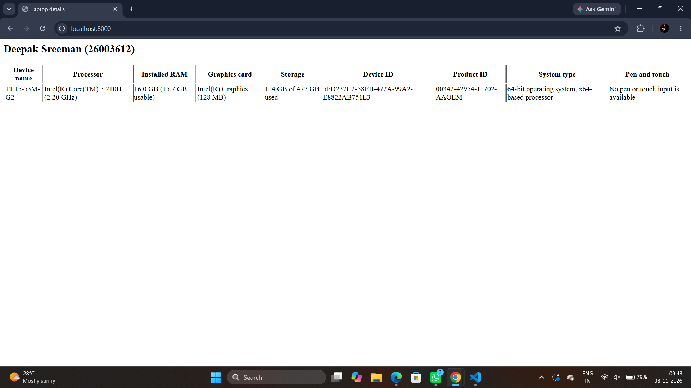
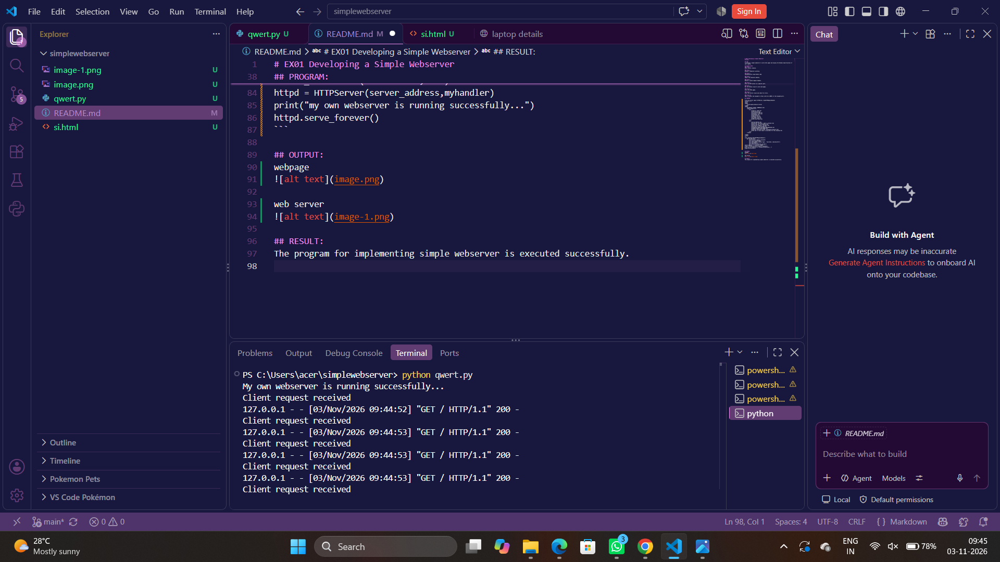

# EX01 Developing a Simple Webserver
## Date: 28.10.2026

## AIM:
To develop a simple webserver to serve html pages and display the Windows Specifications of your Laptop.

## DESIGN STEPS:
### Step 1: 
HTML content creation.

### Step 2:
Design of webserver workflow.

### Step 3:
Implementation using Python code.

### Step 4:
Import the necessary modules.

### Step 5:
Define a custom request handler.

### Step 6:
Start an HTTP server on a specific port.

### Step 7:
Run the Python script to serve web pages.

### Step 8:
Serve the HTML pages.

### Step 9:
Start the server script and check for errors.

### Step 10:
Open a browser and navigate to http://127.0.0.1:8000 (or the assigned port).

## PROGRAM:
```
from http.server import HTTPServer, BaseHTTPRequestHandler
content = """
<html>
<head>
    <title>laptop details</title>
</head>
<body>
    <h2>Deepak Sreeman (26003612)</h2>
    <table border="1">
        <tr>
            <th>Device name</th>
            <th>Processor</th>
            <th>Installed RAM</th>
            <th>Graphics card</th>
            <th>Storage</th>
            <th>Device ID</th>
            <th>Product ID</th>
            <th>System type</th>
            <th>Pen and touch</th>
        </tr>
        <tr>
            <td>TL15-53M-G2</td>
            <td>Intel(R) Core(TM) 5 210H (2.20 GHz)</td>
            <td>16.0 GB (15.7 GB usable)</td>
            <td>Intel(R) Graphics (128 MB)</td>
            <td>114 GB of 477 GB used</td>
            <td>5FD237C2-58EB-472A-99A2-E8822AB751E3</td>
            <td>00342-42954-11702-AAOEM</td>
            <td>64-bit operating system, x64-based processor</td>
            <td>No pen or touch input is available for this display</td>
        </tr>
    </table>

</body>
</html>
"""
class myhandler(BaseHTTPRequestHandler):
    def do_GET(self):
        print("Client request received")
        self.send_response(200)
        self.send_header('content-type', 'text/html; charset=utf-8')
        self.end_headers()
        self.wfile.write(content.encode())
server_address = ('localhost',8000)
httpd = HTTPServer(server_address,myhandler)
print("my own webserver is running successfully...")
httpd.serve_forever()
```

## OUTPUT:
webpage


web server


## RESULT:
The program for implementing simple webserver is executed successfully.
